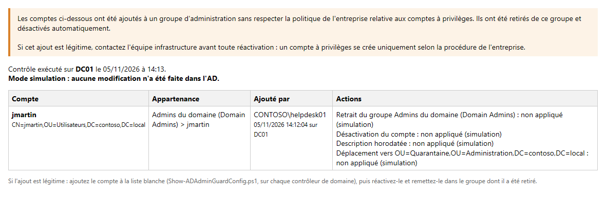
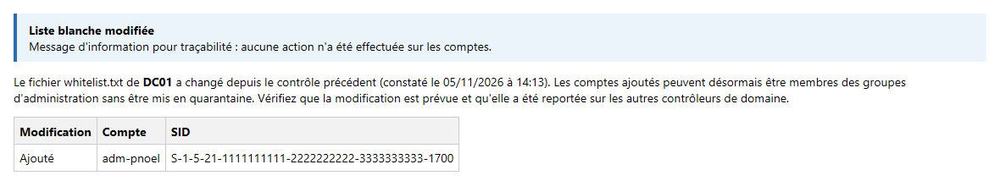
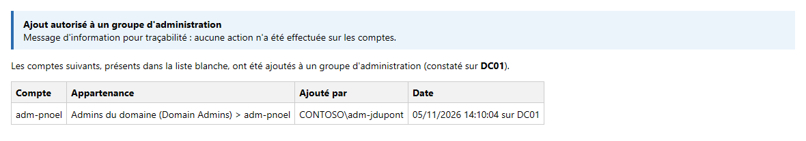
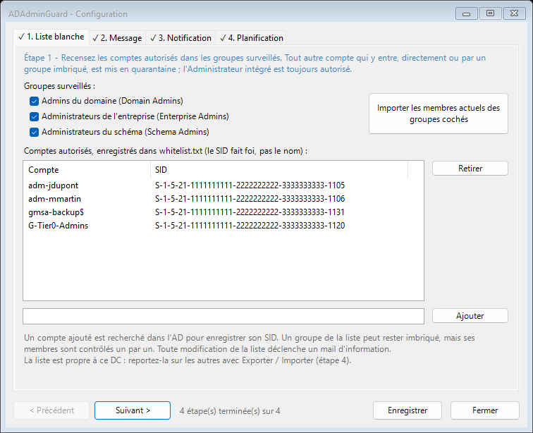
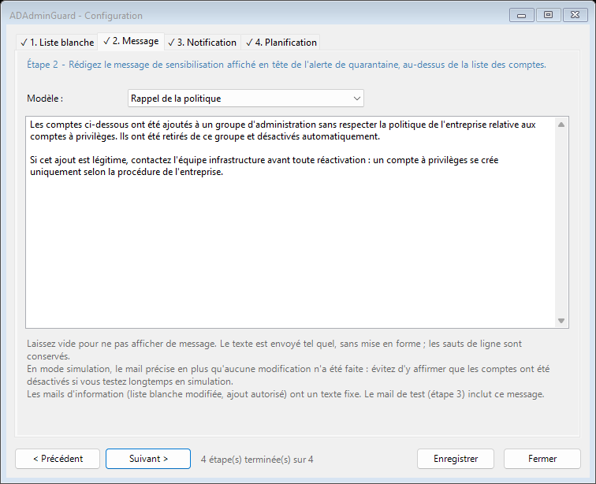
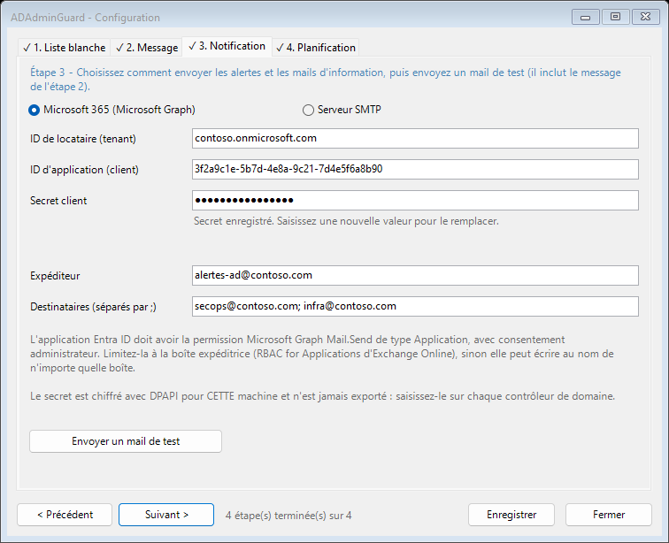
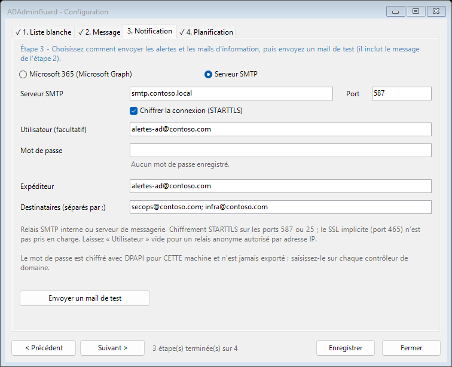
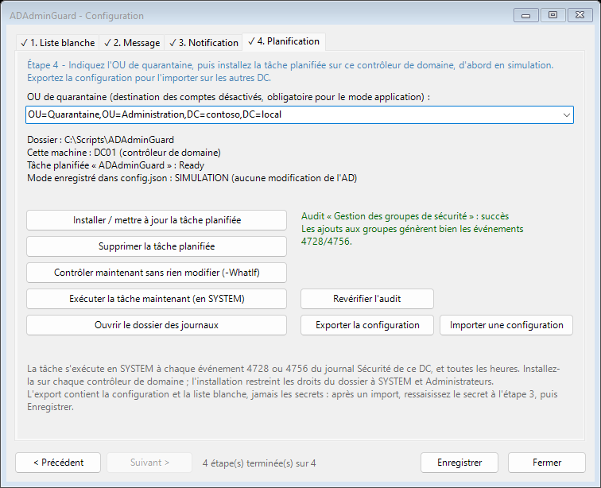
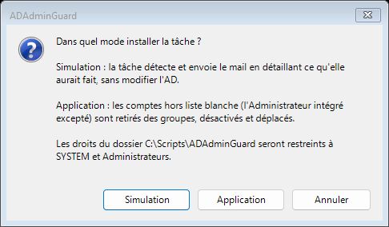

<h1> ADAdminGuard</h1>

[](https://ko-fi.com/code4human)

Garde-fou pour les groupes à privilèges d'Active Directory. Seuls les comptes d'une **liste blanche** (et le compte
**Administrateur intégré**) peuvent être membres des groupes **Admins du domaine**, **Administrateurs de
l'entreprise** et **Administrateurs du schéma**, directement ou par un groupe imbriqué. Tout autre compte qui y
entre est mis en quarantaine, et une alerte part par mail.

Le contrôle tourne sur chaque contrôleur de domaine, en tâche planifiée SYSTEM, déclenchée par les événements
de sécurité 4728 / 4756 et rejouée toutes les heures. Un configurateur graphique (WinForms) guide la mise en place
en quatre étapes. Les mails partent par Microsoft 365 (Graph) ou par un serveur SMTP classique.

> **Ce que ADAdminGuard est, et n'est pas.** C'est un contrôle de conformité et un détecteur rapide : chaque
> compte d'administration doit être autorisé explicitement, et tout ajout est tracé. Ce n'est pas une barrière
> contre un attaquant déjà administrateur du domaine ou du DC, qui peut désactiver la tâche ou modifier la liste
> blanche. Il complète le modèle d'administration en tiers, la délégation restreinte et une supervision (SIEM,
> Defender for Identity), sans les remplacer.

---

## Sommaire

- [Fonctionnement](#fonctionnement)
- [Prérequis](#prérequis)
- [Installation](#installation)
- [Configuration](#configuration)
- [Plusieurs contrôleurs de domaine](#plusieurs-contrôleurs-de-domaine)
- [Application Entra ID pour l'envoi des mails](#application-entra-id-pour-lenvoi-des-mails)
- [Envoi par serveur SMTP](#envoi-par-serveur-smtp)
- [Mise en service conseillée](#mise-en-service-conseillée)
- [Ajouter un administrateur](#ajouter-un-administrateur)
- [Journalisation](#journalisation)
- [Exécution manuelle](#exécution-manuelle)
- [Sécurité](#sécurité)
- [Limites connues](#limites-connues)
- [Dépannage](#dépannage)
- [Fichiers](#fichiers)

---

## Fonctionnement

### Déclenchement

La tâche planifiée `ADAdminGuard` s'exécute en **SYSTEM** sur chaque contrôleur de domaine :

| Déclencheur | Rôle |
|---|---|
| Événement **4728** du journal Sécurité | Ajout d'un membre à un groupe de sécurité **global** (ex. Admins du domaine) |
| Événement **4756** du journal Sécurité | Ajout d'un membre à un groupe de sécurité **universel** (ex. Administrateurs de l'entreprise, du schéma) |
| **Toutes les heures** | Rattrapage : ajout traité par un autre DC, DC arrêté, événement manqué |

Tout ajout à un groupe global ou universel déclenche le contrôle, y compris l'ajout à un groupe imbriqué dans un
groupe surveillé.

Dans le Planificateur de tâches, le contrôle horaire apparaît comme un déclencheur **« Une fois »** à la date
d'installation, avec **« Après le déclenchement, recommencer toutes les 1 heure »** : il se répète sans fin. Il
rattrape ce que le déclencheur par événement ne voit pas, puisque l'événement 4728 / 4756 n'est écrit que sur le DC
qui a traité l'ajout :

- ajout traité par un autre DC, sur lequel la tâche n'a pas tourné ;
- DC ou service de tâches arrêté au moment de l'ajout ;
- audit désactivé, par erreur ou volontairement ;
- compte revenu dans un groupe sans ajout classique (restauration depuis la corbeille AD ou une sauvegarde).

Il met aussi à jour `state.json` et détecte une modification de la liste blanche même sans ajout à un groupe.
Ne pas le supprimer : sans lui, une seule défaillance du déclencheur par événement laisserait un compte non
autorisé en place indéfiniment.

### Règle

Les groupes surveillés sont identifiés par leur **SID** (RID 512, 519 et 518), pas par leur nom : le contrôle
fonctionne quelle que soit la langue de l'Active Directory.

Chaque groupe surveillé est parcouru **avec ses groupes imbriqués, à tous les niveaux**. Un membre, direct ou
indirect, n'est admis que s'il est :

- l'**Administrateur intégré** (RID 500), toujours admis ;
- ou présent dans la **liste blanche** (`whitelist.txt`), reconnu par son **SID** : renommer un compte avec le nom
  d'un compte autorisé ne permet pas de passer.

Le contrôle porte sur **tout le domaine**, quel que soit l'emplacement du compte.

Un **groupe imbriqué** présent dans la liste blanche est autorisé à rester imbriqué, mais **ses membres sont
contrôlés un par un**. Absent de la liste, il est signalé dans l'alerte ; ses membres sont contrôlés de toute façon.

### Actions sur un compte non autorisé

1. **Retrait du groupe qui le contient directement** : le groupe surveillé, ou le groupe imbriqué par lequel il
   obtient ses droits (le retirer du seul groupe surveillé ne servirait à rien) ;
2. **Désactivation** du compte ;
3. **Description horodatée** : `[ADAdminGuard AAAA-MM-JJ HH:mm] Quarantaine : …`, l'ancienne description
   est conservée à la suite ;
4. **Déplacement** dans l'OU de quarantaine.

Les ordinateurs, comptes de service gérés (gMSA), groupes et objets non résolus ne sont jamais modifiés :
ils sont seulement signalés.

### Modes

| Mode | Effet |
|---|---|
| **Simulation** (par défaut) | Détection et mails, **aucune modification de l'AD**. L'alerte et le journal détaillent chaque action qui aurait été faite. |
| **Application** | Les actions ci-dessus sont appliquées. |

Le mode est choisi à l'installation de la tâche, enregistré dans `config.json` et relu à chaque exécution.

### Mails

| Mail | Quand | Contenu |
|---|---|---|
| **Alerte de quarantaine** | Un compte non autorisé est trouvé dans un groupe surveillé | Message de sensibilisation personnalisable (encadré orange), puis pour chaque compte : DN, **chemin d'appartenance** (ex. `Administrateurs de l'entreprise > G-Tier0-Admins > jdupont`), auteur et date de l'ajout, actions faites ou prévues |
| **Information : liste blanche modifiée** | `whitelist.txt` a changé sur ce DC depuis l'exécution précédente, y compris par une modification à la main | Comptes ajoutés et retirés, avec leur SID (encadré bleu, aucune action) |
| **Information : ajout autorisé** | Un compte de la liste blanche (ou l'Administrateur intégré) a été ajouté à un groupe surveillé ou à un groupe imbriqué | Compte, chemin d'appartenance, auteur et date de l'ajout (encadré bleu, aucune action) |

Les mails d'information sont envoyés par le DC concerné : celui dont la liste blanche a changé, ou celui qui a
traité l'ajout (l'événement 4728 / 4756 n'est écrit que sur ce DC). Au **premier passage** après l'installation,
le contrôle enregistre un état de référence sans envoyer de mail d'information.

**Alerte de quarantaine** (ici en mode simulation) :



**Information : liste blanche modifiée** :



**Information : ajout autorisé** :



### Auteur de l'ajout

L'alerte et le mail d'ajout autorisé indiquent qui a fait l'ajout et quand :

1. l'événement 4728 / 4756 correspondant est recherché dans le journal Sécurité du DC qui exécute le contrôle ;
2. à défaut, la **date et le DC d'origine** de l'ajout sont lus dans les métadonnées de réplication de l'attribut
   `member`, puis l'événement est recherché dans le journal Sécurité de ce DC d'origine.

Si le journal d'un autre DC n'est pas lisible (cas de SYSTEM, voir [Limites](#limites-connues)), l'alerte donne au
moins la date et le DC à consulter. Le mail « liste blanche modifiée » ne peut pas nommer l'auteur : un fichier
modifié ne laisse pas d'événement de sécurité par défaut.

---

## Prérequis

| Élément | Exigence |
|---|---|
| Système | Contrôleur de domaine Windows Server 2016 ou plus récent |
| PowerShell | Windows PowerShell 5.1 |
| Module | `ActiveDirectory` (présent sur un DC) |
| Droits | Administrateur du DC pour installer la tâche ; la tâche tourne ensuite en SYSTEM |
| Audit | **Auditer la gestion des groupes de sécurité : Succès** (stratégie d'audit avancée) |
| Mail, au choix | **Microsoft 365** : une application Entra ID avec la permission Graph **Mail.Send** (application) et une boîte expéditrice<br>**SMTP** : un serveur ou relais SMTP joignable depuis le DC |
| Réseau | Microsoft 365 : HTTPS sortant vers `login.microsoftonline.com` et `graph.microsoft.com`<br>SMTP : accès au serveur sur le port choisi (587 ou 25) |

### Activer l'audit

Par GPO liée à l'OU **Domain Controllers** :

`Configuration ordinateur > Stratégies > Paramètres Windows > Paramètres de sécurité > Configuration avancée de la
stratégie d'audit > Gestion des comptes > Auditer la gestion des groupes de sécurité` : **Succès**.

Sans cet audit, la tâche ne réagit qu'au contrôle horaire, l'auteur des ajouts reste inconnu et le mail « ajout
autorisé » n'est pas envoyé. L'étape **4. Planification** du configurateur affiche l'état effectif de l'audit sur le DC.

---

## Installation

1. Copier le dossier sur **chaque contrôleur de domaine**, par exemple dans `C:\Scripts\ADAdminGuard`.
2. Lancer **`Configurer-ADAdminGuard.bat`** : il demande l'élévation si nécessaire, puis ouvre le configurateur.
3. Suivre les étapes 1 à 3 du configurateur (voir [Configuration](#configuration)), puis cliquer sur **Enregistrer**.
4. Étape **4. Planification** : renseigner l'OU de quarantaine, puis **Installer / mettre à jour la tâche
   planifiée** et choisir **Simulation** ou **Application**.
5. Reporter la configuration sur les autres DC : voir [Plusieurs contrôleurs de domaine](#plusieurs-contrôleurs-de-domaine).

L'installation :

- crée ou met à jour la tâche planifiée `ADAdminGuard` ;
- crée la source d'événements `ADAdminGuard` dans le journal Application ;
- **restreint les droits du dossier à SYSTEM et Administrateurs** (voir [Sécurité](#sécurité)).

---

## Configuration

Le configurateur `Show-ADAdminGuardConfig.ps1` (lancé par le `.bat`) guide la mise en place en **quatre étapes
numérotées**, parcourues avec **Précédent / Suivant** ou directement par les onglets. Une coche ✓ marque chaque
étape terminée et un compteur indique la progression. L'installation de la tâche reste **bloquée tant que
l'étape 1 n'est pas faite**. **Enregistrer** écrit `config.json` et `whitelist.txt` à tout moment.

### Étape 1 : liste blanche

| Élément | Description |
|---|---|
| **Groupes surveillés** | Admins du domaine, Administrateurs de l'entreprise, Administrateurs du schéma. |
| **Importer les membres actuels des groupes cochés** | Ajoute tous les membres, directs et imbriqués (groupes imbriqués compris), avec leur SID. L'Administrateur intégré n'est pas ajouté : il est toujours autorisé. |
| **Liste** | Comptes autorisés, colonnes *Compte* et *SID*, enregistrés dans `whitelist.txt`. |
| **Ajouter** | Le nom saisi est recherché dans l'AD pour enregistrer son SID. Un nom introuvable peut être ajouté après confirmation : il est alors comparé sur son nom seul. |

À faire **avant toute mise en service** : un compte existant absent de la liste serait mis en quarantaine.
Par sécurité, le contrôle **refuse de s'exécuter tant que `whitelist.txt` n'existe pas**.
Terminée quand au moins un groupe est coché et la liste n'est pas vide.



### Étape 2 : message

Texte de sensibilisation affiché en tête de l'alerte de quarantaine. Quatre modèles sont proposés : *Rappel de la
politique* (par défaut), *Sensibilisation*, *Alerte sécurité* et *Court*. Choisir un modèle remplace le texte
aussitôt ; *Aucun message* supprime l'encadré ; toute modification à la main fait passer la liste sur
*Personnalisé*. À la réouverture, l'option correspondant au texte enregistré est présélectionnée.

Les modèles affirment que les comptes « ont été désactivés » : en simulation prolongée, adapter le texte (le mail
précise de toute façon qu'aucune modification n'a été faite). Les mails d'information ont un texte fixe.



### Étape 3 : notification

Choix de la méthode d'envoi, puis paramètres communs. Les trois types de mails utilisent ces paramètres.

**Microsoft 365 (Microsoft Graph)** — voir [Application Entra ID](#application-entra-id-pour-lenvoi-des-mails) :

| Champ | Description |
|---|---|
| **ID de locataire** | GUID du locataire Entra ID, ou son nom de domaine. |
| **ID d'application (client)** | GUID de l'application (page *Vue d'ensemble*). |
| **Secret client** | *Valeur* du secret (pas son ID). |

**Serveur SMTP** — voir [Envoi par serveur SMTP](#envoi-par-serveur-smtp) :

| Champ | Description |
|---|---|
| **Serveur SMTP / Port** | Nom ou adresse du serveur, port 587 (soumission) ou 25 (relais). |
| **Chiffrer la connexion (STARTTLS)** | Recommandé. Le SSL implicite (port 465) n'est pas pris en charge. |
| **Utilisateur** | Facultatif : vide pour un relais anonyme autorisé par adresse IP. |
| **Mot de passe** | Requis si un utilisateur est saisi. |

**Communs** : **Expéditeur** et **Destinataires** (séparés par `;`).

Les secrets (secret client, mot de passe SMTP) sont affichés en points une fois enregistrés ; saisir une nouvelle
valeur pour les remplacer. **Envoyer un mail de test** envoie un mail avec le message de l'étape 2, pour aperçu.
En cas d'échec, le message affiche la cause : motif Entra ID / Graph (`AADSTS…`, permission manquante…) ou
erreur du serveur SMTP. Terminée quand les champs de la méthode choisie sont remplis.

| Microsoft 365 (Graph) | Serveur SMTP |
|---|---|
|  |  |

### Étape 4 : planification

| Élément | Effet |
|---|---|
| **OU de quarantaine** | Destination des comptes désactivés. Obligatoire en mode application ; son existence est vérifiée à l'enregistrement. |
| **Installer / mettre à jour la tâche planifiée** | Enregistre la configuration, demande le mode (**Simulation** / **Application**), installe la tâche. Prévient si l'audit est inactif ou la notification non configurée. |
| **Supprimer la tâche planifiée** | Désinstalle la tâche sur ce DC. |
| **Contrôler maintenant sans rien modifier (-WhatIf)** | Lance le contrôle dans une console, avec le compte courant. L'alerte est envoyée s'il y a un compte non autorisé ; les mails d'information ne le sont pas. |
| **Exécuter la tâche maintenant (en SYSTEM)** | Lance la vraie tâche planifiée : test le plus fidèle d'un déclenchement automatique. |
| **Ouvrir le dossier des journaux** | Ouvre `logs\`. |
| **Revérifier l'audit** | Relit l'état effectif de l'audit « Gestion des groupes de sécurité ». |
| **Exporter / Importer une configuration** | Voir [Plusieurs contrôleurs de domaine](#plusieurs-contrôleurs-de-domaine). |

L'étape affiche aussi l'état de la tâche, le mode enregistré et l'état de l'audit. Terminée quand la tâche est
installée.



À l'installation, le mode est choisi explicitement ; **Entrée** choisit Simulation, le choix sans risque :



### Fichiers `config.json` et `whitelist.txt`

```json
{
  "Groups": ["DomainAdmins", "EnterpriseAdmins", "SchemaAdmins"],
  "QuarantineOU": "OU=Quarantaine,OU=Administration,DC=contoso,DC=local",
  "SimulationMode": true,
  "MailMessage": "Les comptes ci-dessous …",
  "Mail": {
    "Method": "Graph",
    "TenantId": "00000000-0000-0000-0000-000000000000",
    "ClientId": "00000000-0000-0000-0000-000000000000",
    "SecretProtected": "<secret chiffré DPAPI, propre à la machine>",
    "SmtpServer": "",
    "SmtpPort": 587,
    "SmtpSsl": true,
    "SmtpUser": "",
    "SmtpPasswordProtected": "",
    "From": "alertes-ad@contoso.com",
    "To": "secops@contoso.com;admin@contoso.com"
  }
}
```

`Method` vaut `Graph` (Microsoft 365) ou `Smtp`.

```text
# Comptes autorisés dans les groupes surveillés par ADAdminGuard : « sAMAccountName;SID », # = commentaire.
adm-jdupont;S-1-5-21-1111111111-2222222222-3333333333-1105
G-Tier0-Admins;S-1-5-21-1111111111-2222222222-3333333333-1120
```

Une ligne sans SID (`nom` seul) est comparée sur le nom ; le journal du contrôle le signale à chaque exécution.

---

## Plusieurs contrôleurs de domaine

La configuration, la liste blanche et l'état sont **propres à chaque DC** : rien n'est répliqué automatiquement.
C'est voulu : la liste blanche ne peut être modifiée que par un administrateur d'un DC, et non par quiconque
aurait reçu des droits sur un objet de l'annuaire.

Pour reporter une configuration :

1. Sur le DC de référence, étape 4 : **Exporter la configuration**. Le fichier `.json` contient la configuration
   et la liste blanche, **jamais les secrets**.
2. Sur chaque autre DC : **Importer une configuration**, vérifier les étapes, ressaisir le secret client ou le mot de
   passe SMTP à l'étape 3 s'il n'est pas déjà enregistré sur ce DC, puis **Enregistrer** et installer la tâche.

Les SID étant communs à tout le domaine, la liste blanche exportée est valable sur tous les DC. Une liste blanche
non reportée sur un DC fait mettre en quarantaine, par ce DC, le compte qui y manque, au plus tard au contrôle
horaire suivant.

---

## Application Entra ID pour l'envoi des mails

1. **Entra ID > Inscriptions d'applications > Nouvelle inscription** (compte unique du locataire, sans URI de redirection).
2. **Autorisations de l'API > Ajouter > Microsoft Graph > Autorisations d'application > `Mail.Send`**, puis
   **Accorder le consentement administrateur**.
3. **Certificats et secrets > Nouveau secret client** : copier la **Valeur** (affichée une seule fois).
4. **Restreindre l'application à la boîte expéditrice.** Sans restriction, `Mail.Send` permet d'envoyer au nom de
   n'importe quelle boîte du locataire. Avec Exchange Online (RBAC for Applications) :

```powershell
Connect-ExchangeOnline
New-ServicePrincipal -AppId <ID d'application> -ObjectId <ID d'objet de l'application d'entreprise> -DisplayName 'ADAdminGuard'
New-ManagementScope -Name 'ADAdminGuard-Expediteur' -RecipientRestrictionFilter "PrimarySmtpAddress -eq 'alertes-ad@contoso.com'"
New-ManagementRoleAssignment -App <ID d'application> -Role 'Application Mail.Send' -CustomResourceScope 'ADAdminGuard-Expediteur'
```

Retirer ensuite la permission `Mail.Send` accordée à l'étape 2 dans Entra ID : c'est l'attribution Exchange qui
fait foi, limitée à la boîte expéditrice.

Penser à **renouveler le secret avant son expiration** : un secret expiré fait échouer l'envoi, ce qui est consigné
dans le journal du script et dans le journal Application (ID 1002).

---

## Envoi par serveur SMTP

Pour les environnements sans Microsoft 365 : relais SMTP interne (Exchange, Postfix…) ou serveur de messagerie
d'un fournisseur.

- **Relais interne anonyme** : port 25, utilisateur vide. Autoriser le relais depuis l'adresse IP de chaque DC sur
  le serveur SMTP.
- **Serveur authentifié** : port 587, STARTTLS coché, utilisateur et mot de passe d'une boîte dédiée aux alertes.
- Le **SSL implicite (port 465)** n'est pas pris en charge par le client SMTP de .NET : utiliser 587 avec STARTTLS.
- Le mot de passe est chiffré avec DPAPI pour la machine, comme le secret client.

L'envoi SMTP de Microsoft 365 (`smtp.office365.com`) en authentification de base est en cours de retrait par
Microsoft : avec un locataire Microsoft 365, préférer la méthode Graph.

---

## Mise en service conseillée

1. Activer l'audit sur les DC et vérifier qu'il apparaît en vert à l'étape **4. Planification**.
2. Sur un premier DC : **importer les membres actuels** dans la liste blanche (étape 1), la relire et retirer les
   comptes qui n'ont rien à faire dans ces groupes, puis suivre les étapes 2 et 3 et **Enregistrer**.
3. **Envoyer un mail de test** (étape 3).
4. Installer la tâche en **Simulation** (étape 4).
5. **Exporter** la configuration et l'**importer** sur chaque autre DC, avec le secret, puis y installer la tâche
   en simulation.
6. Ajouter un compte de test hors liste blanche à *Admins du domaine* : vérifier l'alerte (chemin d'appartenance,
   auteur, actions prévues) et le journal.
7. Laisser tourner quelques jours en simulation pour repérer les comptes légitimes oubliés.
8. Réinstaller la tâche en **Application** sur chaque DC.

---

## Ajouter un administrateur

1. Sur **chaque** DC (ou sur un DC puis Exporter / Importer) : étape 1, **Ajouter** le compte à la liste blanche,
   **Enregistrer**. Un mail « liste blanche modifiée » part de chaque DC modifié.
2. Ajouter ensuite le compte au groupe d'administration. Un mail « ajout autorisé » trace l'opération.

Dans l'ordre inverse, le compte est mis en quarantaine dès son ajout au groupe.

---

## Journalisation

| Emplacement | Contenu |
|---|---|
| `logs\ADAdminGuard_AAAAMMJJ.log` | Un fichier par jour, purgé après 90 jours : configuration lue, état de l'audit, nombre d'événements lus, comptes non autorisés, actions, modifications de la liste blanche, ajouts autorisés, envois de mails, erreurs. |
| Journal **Application**, source `ADAdminGuard` | Pour la supervision (SIEM) : |
| — ID **1000** (Avertissement) | Compte mis en quarantaine |
| — ID **1001** (Avertissement) | Compte non autorisé détecté sans action (simulation, `-WhatIf`, objet autre qu'un utilisateur) |
| — ID **1002** (Erreur) | Erreur du contrôle ou échec de l'envoi d'un mail |
| — ID **1003** (Information) | Liste blanche modifiée sur ce DC |
| — ID **1004** (Information) | Ajout autorisé à un groupe d'administration |
| `state.json` | État entre deux exécutions : dernier événement traité, liste blanche vue. Le supprimer refait un passage de référence, sans mail d'information. |

---

## Exécution manuelle

```powershell
# Contrôle sans rien modifier : affiche les actions prévues et envoie l'alerte s'il y a lieu
.\Invoke-ADAdminGuard.ps1 -WhatIf

# Fenêtre de lecture des événements 4728/4756 (minutes, 120 par défaut) et dossier de journaux
.\Invoke-ADAdminGuard.ps1 -EventLookbackMinutes 240 -LogDir D:\Logs\ADAdminGuard
```

À lancer dans une console **élevée** : la lecture du journal Sécurité l'exige. Avec `-WhatIf`, les mails
d'information ne sont pas envoyés et `state.json` n'est pas mis à jour.

---

## Sécurité

- **Droits du dossier.** Le script s'exécute en SYSTEM sur un contrôleur de domaine : quiconque pourrait le
  modifier obtiendrait ces droits. L'installation retire l'héritage et limite le dossier à SYSTEM et Administrateurs.
  Ne pas placer le dossier sur un partage.
- **Liste blanche.** Locale à chaque DC, modifiable seulement par ses administrateurs, et toute modification est
  signalée par mail. À tenir courte et à revoir régulièrement : chaque entrée est un compte d'administration admis.
- **Secret client et mot de passe SMTP.** Chiffrés avec DPAPI en portée machine : lisibles uniquement sur le DC qui
  les a enregistrés, jamais stockés en clair, jamais affichés par le configurateur, jamais exportés.
- **Mode simulation par défaut**, et refus de fonctionner sans liste blanche : une mauvaise configuration ne peut
  pas mettre en quarantaine les administrateurs en place.

---

## Limites connues

- **Contournable par un administrateur du domaine ou du DC** : il peut désactiver la tâche ou modifier la liste
  blanche (ce qui est signalé par mail). Superviser les événements 4728 / 4756 et les ID 1002 / 1003 dans un SIEM.
- **Journal Sécurité des autres DC.** En SYSTEM, la tâche agit avec le compte ordinateur du DC, qui ne peut pas lire
  par défaut le journal Sécurité d'un autre DC. L'auteur est trouvé quand l'ajout a été traité par le DC qui exécute
  le contrôle, ce qui est le cas des déclenchements par événement. Pour un rattrapage horaire d'un ajout fait
  ailleurs, l'alerte indique la date et le DC à consulter.
- **Mails d'alerte en double.** Le contrôle horaire tourne sur chaque DC : une anomalie qui persiste (mode
  simulation) peut être signalée par plusieurs DC.
- **Forêt multi-domaines.** Les groupes Administrateurs de l'entreprise et du schéma sont lus dans le domaine racine
  de la forêt ; le fonctionnement a été conçu et testé pour une forêt à domaine unique.
- **Domaine local.** Les ajouts à un groupe de domaine local (événement 4732, ex. *Administrateurs* intégré) ne
  sont pas surveillés.

---

## Dépannage

| Symptôme | Cause probable |
|---|---|
| `whitelist.txt absent` dans le journal | Importer les membres actuels à l'étape 1, puis Enregistrer. |
| Un administrateur légitime mis en quarantaine | Absent de la liste blanche d'au moins un DC : l'ajouter partout (Exporter / Importer), puis le réactiver et le remettre dans son groupe. |
| « Entrée(s) de liste blanche sans SID » dans le journal | Ligne au format ancien ou compte introuvable à l'ajout : rouvrir le configurateur, retirer et rajouter le compte, Enregistrer. |
| « Ajouté par » inconnu | Audit inactif sur le DC, ajout traité par un autre DC, ou journal Sécurité illisible : le journal du script précise le cas (nombre d'événements lus, DC d'origine, SID vus). |
| Pas de mail « ajout autorisé » | Audit inactif, ajout traité par un autre DC (c'est lui qui envoie le mail), ou premier passage après l'installation. |
| `AADSTS7000215` / `invalid_client` | Secret erroné : saisir la *Valeur* du secret, pas son ID. |
| `AADSTS700016` | ID d'application erroné ou application d'un autre locataire. |
| `ErrorAccessDenied` à l'envoi | Permission `Mail.Send` absente, consentement non accordé, ou boîte expéditrice hors du périmètre RBAC. |
| `Envoi SMTP via … : refusée` / délai dépassé | Serveur ou port injoignable depuis le DC (pare-feu), ou mauvais port. |
| `5.7.1` / relais refusé | Relais anonyme non autorisé pour l'adresse IP du DC, ou authentification requise. |
| `Secret illisible sur <DC>` | `config.json` copié depuis une autre machine : ressaisir le secret client ou le mot de passe SMTP sur ce DC. |
| Audit « non vérifiable » | Configurateur lancé sans élévation : passer par `Configurer-ADAdminGuard.bat`. |

---

## Fichiers

| Fichier | Rôle |
|---|---|
| `Configurer-ADAdminGuard.bat` | Lanceur du configurateur, avec élévation automatique. |
| `Show-ADAdminGuardConfig.ps1` | Configurateur graphique en quatre étapes. |
| `Invoke-ADAdminGuard.ps1` | Contrôle, exécuté par la tâche planifiée. |
| `ADAdminGuard.psm1` | Fonctions communes : configuration, liste blanche, état, export / import, secrets, envoi Graph et SMTP, AD, tâche planifiée. |
| `ADAdminGuard.ico` | Icône du configurateur (facultative). |
| `config.json` | Configuration, créée par le configurateur (non versionnée). |
| `whitelist.txt` | Liste blanche, créée par le configurateur (non versionnée). |
| `state.json` | État entre deux exécutions (non versionné). |
| `logs\` | Journaux quotidiens (non versionnés). |

Tous les scripts sont compatibles Windows PowerShell 5.1 et encodés en UTF-8 avec BOM.

---

<p align="center">Si ADAdminGuard vous rend service, vous pouvez m'offrir un café :</p>
<p align="center"><a href="https://ko-fi.com/code4human"></a></p>
